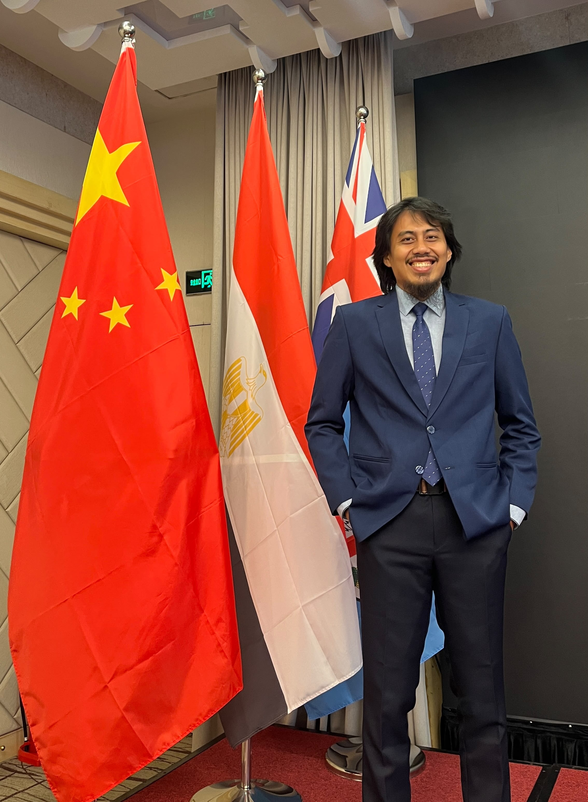

I'm **Rifqi Muhammad Harrys**, a geospatial mapping professional from Indonesia. I work as an Expert Mapping Surveyor at the [Geospatial Information Agency (BIG)](https://www.big.go.id/), in its marine and coastal topographic mapping directorate.

I earned a bachelor's degree in Geodesy and Geomatics Engineering from Institut Teknologi Bandung (ITB). Since joining BIG in 2018, I have worked on mapping projects that combine field surveys, geospatial data processing, and remote sensing.

::: {.text-center}
{fig-align="center" width="55%"}
:::

## What I work on

My work focuses on collecting and preparing reliable geospatial information for marine and coastal areas. Depending on the project, that can include:

- Bathymetric surveys using single-beam and multi-beam echo sounders
- Coastline mapping and updating
- Satellite-derived bathymetry for shallow-water areas
- GNSS surveying and data processing
- Integrating survey and remotely sensed data into mapping products

I have also worked in GIS roles supporting land and building tax mapping and geological-hazard mapping. Those experiences shaped my interest in applying geospatial data to practical public-sector needs.

## Research and projects

I am especially interested in marine and coastal mapping, remote sensing, satellite-derived bathymetry, and geospatial data infrastructure. Alongside work projects, I develop and contribute to software and workflows for geospatial analysis.

- Browse my [projects](projects.qmd), including the [Satellite-Derived Bathymetry GUI](https://github.com/rifqiharrys/sdb_gui).
- Read my [publications](publications.qmd) on bathymetry, elevation data, and tsunami hazard assessment.

## Get in touch

For professional questions or collaboration, connect with me on [LinkedIn](https://www.linkedin.com/in/rifqiharrys/). You can also find my work on [GitHub](https://github.com/rifqiharrys), [Google Scholar](https://scholar.google.com/citations?user=ls5q9R4AAAAJ&hl=en), [ORCID](https://orcid.org/0009-0000-8254-2492), and [ResearchGate](https://www.researchgate.net/profile/Rifqi-Harrys-2).
