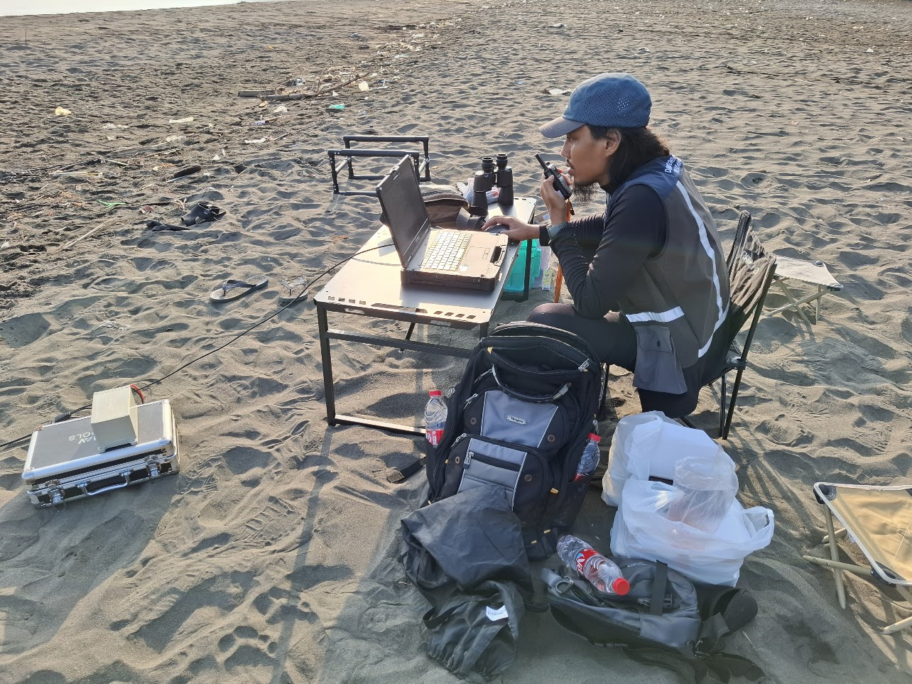

## Marine and Coastal Topographic Mapping of Tegal

**Work Project** | September 2026 - November 2026 | Tegal, Central Java, Indonesia

**Role:** Coordinator of Single-Beam Echo Sounder Survey Team

This project involves conducting coastline mapping, bathymetric survey, tidal observation, and current measurement in Tegal coastal area and the surrounding ocean area until up to 7 km offshore. The purpose of this project is to produce updated coastline data, bathymetric data, and oceanographic data for the Tegal coastal area, which will be used for various purposes such as coastal management, navigation safety, and disaster mitigation.

My role in this project was to ensure that the Single-Beam Echo Sounder (SBES) survey was conducted in accordance with the project requirements and specifications. I was responsible for coordinating the survey team, ensuring that the survey equipment was properly calibrated and maintained, overseeing the data collection process and its processing, and managing the supporting supplies and logistics for the survey.

The picture below is me, while operating the Unmanned Surface Vehicle (USV) during the bathymetric survey in Tegal coastal area. The USV is equipped with a Single-Beam Echo Sounder (SBES) and a GNSS receiver, which allows for accurate bathymetric data collection in shallow water areas that are difficult to access using conventional survey vessels. I was communicating with the USV operator who hold the remote control of the USV to ensure that the USV was operating safely.

## South Kalimantan Bathymetric Surveying and Mapping

**Work Project** | 2025 | South Kalimantan, Indonesia

**Role:** Bathymetric Surveyor

This project was conducted in Pulau Laut Regency, South Kalimantan, Indonesia. The purpose of this project was to produce updated bathymetric data for the project area to support the local government in managing the coastal and marine resources. The bathymetric mapping was conducted using Single-Beam Echo Sounder (SBES) survey and Multibeam Echo Sounder (MBES) survey. My role in this project was to operate the SBES and MBES survey equipment in the field, collect bathymetric data, and process the collected data to produce updated bathymetric maps for the project area.

## Piksel Indonesia Coastlines

**Work Project** | 2025 - Present

**Role:** Contributor

**Links:** [GitHub Repository](https://github.com/piksel-ina/indonesia-coastlines)

Indonesia-coastlines is an application for generating coastline of Indonesia using Piksel Indonesia's cloud computing platform. It is adapted from Digital Earth Australia (DEA) Coastlines, which is an application for generating coastline of Australia using DEA's cloud computing platform. My role in this project is to adapt the DEA Coastlines application to work well within Piksel Indonesia's cloud computing platform and to ensure that the parameters used in the application are suitable for generating coastline of Indonesia.

## Kalimantan and Sulawesi Coastline Mapping using Satellite-Derived Bathymetry (SDB)

**Work Project** | 2024 | Kalimantan and Sulawesi, Indonesia

**Role:** Co-Project Manager and Mapping Surveyor

The purpose of this project was to produce updated coastline data for selected coastal areas in Kalimantan and Sulawesi, Indonesia using bathymetric data generated from the Satellite-Derived Bathymetry (SDB) method. The required field data was shallow water depth data that was collected using an Unmanned Surface Vehicle (USV) equipped with a Single-Beam Echo Sounder (SBES) and a GNSS receiver. The bathymetric data then generated using SDB GUI by inputting the collected shallow water depth data and the satellite imagery of the project area. The coastline then produced by extracting the 0 m depth contour from the generated bathymetric data.

## Togean National Park Bathymetric Surveying and Mapping

**Work Project** | 2024 | Central Sulawesi, Indonesia

**Role:** Bathymetric Surveyor

This project was conducted in Togean National Park, which is a marine protected area located in the Gulf of Tomini, Central Sulawesi. The purpose of this project was to produce updated bathymetric data for Togean National Park to support Balai Taman Nasional Togean (BTNT) or the National Park Management Agency of Togean in managing the marine protected area. The bathymetric mapping was conducted using Single-Beam Echo Sounder (SBES) survey, Multibeam Echo Sounder (MBES) survey, and Satellite-Derived Bathymetry (SDB) method.

## Sulawesi Coastline Mapping using Satellite-Derived Bathymetry (SDB)

**Work Project** | 2023 | Sulawesi, Indonesia

**Role:** Project Manager and Mapping Surveyor

The purpose of this project was to produce updated coastline data for selected coastal areas in Sulawesi, Indonesia using bathymetric data generated from the Satellite-Derived Bathymetry (SDB) method. The required field data was shallow water depth data that was collected using an Unmanned Surface Vehicle (USV) equipped with a Single-Beam Echo Sounder (SBES) and a GNSS receiver. The bathymetric data then generated using SDB GUI by inputting the collected shallow water depth data and the satellite imagery of the project area. The coastline then produced by extracting the 0 m depth contour from the generated bathymetric data.

## East Nusa Tenggara Coastline Mapping using SfM Photogrammetry

**Work Project** | 2023 | Flores, East Nusa Tenggara, Indonesia

**Role:** Control Points Surveyor

This project was conducted along the northern coast of Flores Island, East Nusa Tenggara, Indonesia. The purpose of this project was to produce updated coastline data for the project area using Structure from Motion (SfM) photogrammetry method. Processing aerial photos using SfM photogrammetry method requires control points. There are 3 types of control points that we surveyed in this project, which are base points (which are used for post processing kinematic GNSS data from the drone), ground control points or GCPs (which are used for georeferencing the SfM photogrammetry model), and independent check points or ICPs (which are used for accuracy assessment of the SfM photogrammetry model). My role in this project was to survey the base points, GCPs, and ICPs using GNSS survey method.

## Bunaken National Park Bathymetric Surveying and Mapping

**Work Project** | 2022 | North Sulawesi, Indonesia

**Role:** Project Manager and Mapping Surveyor

This project was conducted in Bunaken National Park, which is a marine protected area located in the northern part of Sulawesi Island. The purpose of this project was to produce updated bathymetric data for Bunaken National Park to support Balai Taman Nasional Bunaken (BTNB) or the National Park Management Agency of Bunaken in managing the marine protected area. The project area covers the waters of Bunaken National Park and the Northern part of Sulawesi Island from South Minahasa Regency to North Minahasa Regency. 

The bathymetric mapping was conducted using Single-Beam Echo Sounder (SBES) survey, Multibeam Echo Sounder (MBES) survey, and Satellite-Derived Bathymetry (SDB) method. Beside project management, I was also responsible for the SDB data processing and the integration of all bathymetric data from SBES, MBES, and SDB into a single bathymetric dataset. The final bathymetric dataset was then used to produce updated bathymetric maps for Bunaken National Park.

## Kepulauan Seribu Bathymetric Surveying and Mapping

**Work Project** | 2021 | Jakarta, Indonesia

**Role:** Bathymetric Surveyor

This project was conducted in the Kepulauan Seribu National Park, which is a marine protected area located in the northern part of Jakarta Bay. The purpose of this project was to produce updated bathymetric data for the Kepulauan Seribu National Park to support Balai Taman Nasional Kepulauan Seribu (BTNKP) or the National Park Management Agency of Kepulauan Seribu in managing the marine protected area.

The bathymetric mapping was conducted using Single-Beam Echo Sounder (SBES) survey, Multibeam Echo Sounder (MBES) survey, and Satellite-Derived Bathymetry (SDB) method (which was piloted during this project). This project was my first time operating the SBES and MBES survey equipment in the field. At the time, I was also responsible for the SDB data processing as a pilot project to test the SDB method for bathymetric mapping in shallow water areas.

## Satellite-Derived Bathymetry (SDB) GUI Software

**Personal Project** | 2020 - Present

**Role:** Developer

**Links:** [GitHub Repository](https://github.com/rifqiharrys/sdb_gui) | 
[DOI](https://doi.org/10.5281/zenodo.8220196)

SDB GUI is a software that I developed to facilitate the process of generating clear shallow water bathymetric data using the Satellite-Derived Bathymetry (SDB) method. The software is designed to be user-friendly and efficient, allowing users to easily input satellite imagery and depth sample data. The bathymetric data is generated using machine learning algorithms, such as Random Forest, K-Nearest Neighbors, and Multiple Linear Regression. This software has supported several projects in my department for coastline mapping and bathymetric mapping in shallow water areas.

## Tidal Analysis (T Tide and U Tide) GUI Software

**Personal Project** | 2020 - 2022

**Role:** Developer

**Links:** [GitHub Repository](https://github.com/rifqiharrys/tide_pyqt5)

This software is my first GUI project that I developed to facilitate the process of tidal analysis using T Tide and U Tide library that originated from MATLAB. The software is designed to be user-friendly and efficient, allowing users to easily input tidal data and perform tidal analysis. Although this software is no longer maintained, the development of this software has given me a starting point to learn about GUI development using PyQt5 in Python.

## Sunda Strait Coastline Mapping using Bathymetric Lidar

**Work Project** | 2020 | Lampung and Banten, Indonesia

**Role:** Bathymetric Lidar data processor

This project was the first use of Airborne Lidar Bathymetry (ALB) for coastline mapping conducted in Indonesia. The project was conducted in the Sunda Strait coastal area, which is a tsunami-prone zone. The use of ALB was intended to provide detailed elevation data of the intertidal zone, which is hard to acquire using conventional survey methods like GNSS or acoustic-based surveys. The ALB system used in this project was using Leica Chiroptera 4X sensor, which use red laser for land and green laser for water.